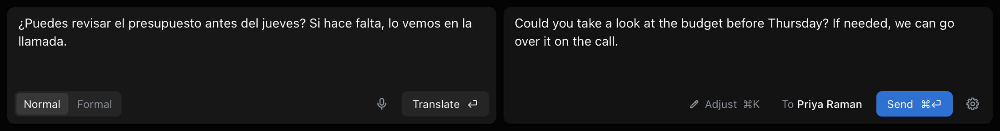

<h1 align="center">Translation Strip</h1>

<p align="center">
  A Mac app that sits in the gap under your Teams window:<br>
  write in Spanish, get English in your own voice, and send it with ⌘⏎.
</p>

<p align="center">
  <b>Version 0.7</b> · macOS 14 or later · For the new Microsoft Teams · Built with Swift and <a href="https://bun.sh">Bun</a>
</p>

<p align="center">
  
  
  
  
</p>

<p align="center">
  <a href="#overview"><b>Overview</b></a> ·
  <a href="#getting-started"><b>Getting started</b></a> ·
  <a href="#use-it"><b>Use it</b></a> ·
  <a href="#privacy"><b>Privacy</b></a> ·
  <a href="#how-it-works"><b>How it works</b></a> ·
  <a href="#ai-assistants"><b>AI assistants</b></a> ·
  <a href="CHANGELOG.md"><b>Changelog</b></a>
</p>

<p align="center">
  
</p>

## Overview

Write the message the way it comes out: in Spanish, mixing Spanish and English, or in rough English. Press Return and the strip gives you the English, in the voice your guide describes. Press ⌘Return and it goes to the chat you have open in Teams, with no copying or pasting.

**What it does differently:**

- **Your voice, not a word-for-word translation.** It carries the meaning in the voice your guide describes and adds nothing you didn't write: no greeting, name, thanks or closing line appears on its own.
- **It sends where you're looking.** ⌘⏎ puts the English in the Teams chat you have open, checks the box holds exactly that text, and sends only if that chat is still the one the strip shows.
- **Your Claude plan, no API key.** A hidden Claude Code session on your plan writes the English. Every message gets a fresh one, so none of them sees what you wrote before.
- **Your linter has the last word.** When the voice linter you point it to finds an error, the app asks for one fix before you see the English. A warning shows above the text.
- **It stays out of the way.** The strip docks on any side of Teams, follows it, and steps aside when Teams is minimized, hidden or on another desktop.

**Requirements:** macOS 14 or later, the new Microsoft Teams, and Claude Code signed in with a Claude plan. To build it, [Bun](https://bun.sh) and the Xcode Command Line Tools.

**Status:** 0.x. It reads Teams through Accessibility, so a Teams update can change what it finds.

> This is an independent project. It isn't made, endorsed or supported by Anthropic or Microsoft. Claude and Claude Code are trademarks of Anthropic, and Microsoft Teams is a trademark of Microsoft.

## Getting started

### Build and install

1. Build the app and install it in `~/Applications`:
   ```bash
   sh app/build.sh --install
   ```
2. From the app menu, use Choose Voice Guide… to pick your guide, a Markdown file that describes how you write. Choose Voice Linter… is optional: the app runs it as `bun <linter> <file> --todo` on each reply.
3. Allow Accessibility when the strip asks. The app needs it to put the message in Teams and to see which chat is open.

macOS ties the Accessibility permission to the app's signature. If your keychain has a code-signing identity named "Translation Strip Local Signing", `build.sh` signs with it and the permission stays after a rebuild. Without one, `build.sh` signs ad hoc and you allow each new build again.

## Use it

The strip docks under the Teams window, as wide as it, and moves with it. When there's no room under Teams, it becomes a column beside Teams, as tall as its window, with the English on top and your Spanish below. Position in the strip's settings menu (the gear), or Layout in the app menu, picks Automatic or a side: below, above, left or right of Teams. Drag the strip's outer edge to make it taller, or the column's to make it wider, and the app remembers the size. The strip steps out of the way when Teams is minimized, hidden or on another desktop.

| Key | What it does |
|---|---|
| ⏎ | Translate |
| ⇧⏎ | New line |
| ⌘⏎ | Send to the open chat |
| ⌘K | Adjust the English with a note, in Spanish or English. Undo puts it back |
| ⌘D | Dictate in Spanish |
| Esc | Clear |
| ⌃⌥T | From any app, bring up the strip ready to type |

Normal and Formal pick the register, as your guide describes them. The settings menu (the gear) sets what ⌘⏎ does (send, or put the message in Teams without sending), picks the model (Haiku, Sonnet or Opus, which runs at low effort), opens your guide and restarts the translator.

### How it sends

The app brings Teams forward, pastes the English into the message box, checks that the box holds exactly that text and then presses Return. It never presses a key while Teams isn't in front, and it sends only if Teams still has open the chat the strip shows next to Send. If you switch chats after translating, the strip says "Written for <name>" and won't send until you translate again or go back to that chat. If the box already has a draft, it stops and lets you add the message after it. If Teams changes the text as it's pasted, for example into a list, the message stays in the box unsent.

## Privacy

The app and its server run on your Mac, and the server listens on `127.0.0.1` only. The only thing that leaves your Mac is what the hidden session sends to Claude.

### What goes to Claude

Through the hidden Claude Code session on your plan:

- What you write, the register and, for Adjust, the current English and your note.
- For context, the open chat's name, the author of its last message and that message. The session treats it as quoted text and never follows instructions in it.
- Your voice guide's text, as the session's instructions. The app reads it from your file when the session starts and never writes it anywhere.

Every message goes to a fresh session, so none of them sees what you wrote before, to whom, or what they wrote you.

Claude Code adds its own context, as it does in any session, such as details about your Mac and your account's email. The session runs with no tools, no MCP servers, no hooks and none of your settings or memory files, and it keeps no transcript.

### What it reads from Teams

Through Accessibility, about once a second while the strip is on screen: the window's position and size, its title for the chat's name, the message box to spot a draft and check what was pasted, and the latest messages in the open chat for context. It stores none of it.

### The clipboard and the microphone

To paste, the app borrows the clipboard for a moment and puts back what was there once Teams has taken the paste, unless you copied something else meanwhile. It marks what it puts there as temporary and private, so clipboard managers that respect those marks don't keep your message.

The microphone listens only while you dictate. Apple's dictation model turns what you say into text on your Mac, in Mexican Spanish (or US or Spain Spanish), and the audio never leaves it. The first time, macOS downloads that model from Apple.

### What it keeps

In `~/.translation-strip`:

- `settings.json`: the paths of your guide and linter, the model and what ⌘⏎ does.
- `server.log`: when the server and the translator started, errors, and outcomes such as "send: not sent (mismatch)". It never holds message text or chat names.
- `translator/`: the hidden session's working folder. The app never reads anything back from it.

The app's preferences keep where the strip last sat. For the linter, each reply goes to a temporary file that the app deletes right after.

### What it sends on its own

Nothing. The hidden session connects to Anthropic the way Claude Code always does.

## How it works

1. The server (`server.ts` and `src/`, Bun) gives each request a fresh Claude Code session with your guide as its instructions, keeping the next one started so replies stay fast. It answers the page one request at a time, runs the linter on each reply, and takes requests only from the app's own page.
2. The page (`public/index.html`, with its state in `public/strip-state.js`) is the strip itself. Its tokens, components and icons come from the family's design system, [mac-app-design](https://github.com/creative-context/mac-app-design), vendored next to it.
3. The app (`app/`, Swift) holds the window under Teams, sending through Accessibility, reading the open chat, dictation and the shortcut. It runs its own copy of the server and stops it when it quits. Its shared parts come from the family's app kit, [mac-app-kit](https://github.com/creative-context/mac-app-kit).

`docs/contract.md` is the contract between the three.

## Develop

```bash
bun test                   # the server's tests and the vendored-files check, port 4811
bun test test/vendored.test.ts  # the vendored files weren't edited
sh test/swift-check.sh     # the docking math and the Teams helpers (needs the Xcode command line tools)
bun test/page-mock.ts      # the page with canned replies, port 4813
bun test/page-check.ts     # every control of the page in WebKit (needs the page mock and Playwright)
bun server.ts              # the server on port 4812: in a browser, a preview that sends nothing
sh app/build.sh            # build into build/
sh app/build.sh --install  # build, copy to ~/Applications and open it
```

`bun docs/screenshot.ts` redraws `docs/screenshot.png` from the page mock, with made-up text.

The tests use a stand-in `claude` and a stand-in linter in temporary folders, so they never touch your data.

## AI assistants

To work on this repository, an agent reads [`AGENTS.md`](AGENTS.md), which `CLAUDE.md` imports.

## License

[MIT](LICENSE).
