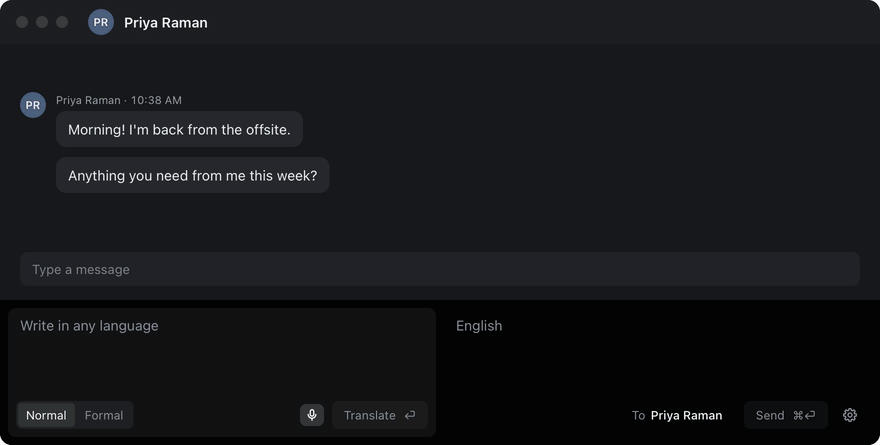

<p align="center">
  <picture>
    <source media="(prefers-color-scheme: dark)" srcset="docs/demo-dark.gif">
    
  </picture>
</p>

<h1 align="center">Translation Strip</h1>

<p align="center">
  A companion for your Teams:<br>
  write in Spanish, get English in your own voice, and send it with ⌘⏎.
</p>

<p align="center">
  <b>Version 0.7</b> · macOS 14 or later · For the new Microsoft Teams · Built with Swift and <a href="https://bun.sh">Bun</a>
</p>

<p align="center">
  
  
  
  
</p>

<p align="center">
  <a href="#install"><b>Install</b></a> ·
  <a href="docs/guide.md"><b>Guide</b></a> ·
  <a href="docs/privacy.md"><b>Privacy</b></a> ·
  <a href="CHANGELOG.md"><b>Changelog</b></a>
</p>

Write the message the way it comes out: in Spanish, mixing Spanish and English, or in rough English. Press Return and the strip gives you the English, in the voice your guide describes. Press ⌘Return and it goes to the chat you have open in Teams, with no copying or pasting.

## Features

- **Your voice, not a word-for-word translation.** It adds nothing you didn't write: no greeting, thanks or closing line on its own.
- **Sends where you're looking.** ⌘⏎ puts the English in the open chat and sends it only if that chat is still the one the strip shows.
- **Your Claude plan, no API key.** A hidden Claude Code session writes the English, a fresh one for every message.
- **Your linter has the last word.** An error it finds gets fixed once before you see the English.
- **Out of the way.** It docks on any side of Teams, follows it, and hides when Teams does.

## Requirements

macOS 14 or later, the new Microsoft Teams, Claude Code signed in with a Claude plan, and [Bun](https://bun.sh), which runs the app's server. To build it yourself, the Xcode Command Line Tools too.

**Status:** 0.x. It reads Teams through Accessibility, so a Teams update can change what it finds.

## Install

Download the zip from the [latest release](https://github.com/creative-context/translation-strip/releases/latest), unzip it and move Translation Strip to Applications. Apple hasn't checked it, so the first time macOS won't open it: go to System Settings › Privacy & Security and choose Open Anyway.

Then pick your voice guide with Choose Voice Guide… in the app menu, and allow Accessibility when the strip asks. To build it yourself, run `sh app/build.sh --install`. [The guide](docs/guide.md#install) has the details.

## Use it

- **⏎** translates, **⇧⏎** starts a new line.
- **⌘⏎** sends to the open chat. **⌘K** adjusts the English with a note. **⌘D** dictates in Spanish.
- **⌃⌥T** brings up the strip from any app.
- The gear picks what ⌘⏎ does, the model and where the strip sits.

All the keys, the positions and how sending works are in [the guide](docs/guide.md).

## Your voice guide

A Markdown file that says how you sound in English: your registers, what you never write, and a few examples. Start from [the example](docs/voice-guide-example.md) or [write your own](docs/guide.md#write-your-voice-guide). An optional [voice linter](docs/guide.md#a-voice-linter-optional) checks every reply against it.

## Privacy

- The app and its server run on your Mac and listen on `127.0.0.1` only.
- What you write, the open chat's name and its last message go to Claude through a fresh Claude Code session on your plan, and nowhere else.
- It keeps no message text: only your settings and a log of what happened.

The whole list is in [docs/privacy.md](docs/privacy.md).

## Uninstall

1. Quit Translation Strip and delete it from `~/Applications`.
2. Delete `~/.translation-strip` and its preferences: `defaults delete com.creativecontext.TranslationStrip`.
3. Remove it from System Settings › Privacy & Security › Accessibility.

## Develop

```bash
bun test                # the server's tests
bun test/page-check.ts  # every control of the page in WebKit
sh app/build.sh         # build into build/
```

How it's built and every command: [docs/architecture.md](docs/architecture.md). The rules for changing the code: [`AGENTS.md`](AGENTS.md).

## License

[MIT](LICENSE).

> This is an independent project. It isn't made, endorsed or supported by Anthropic or Microsoft. Claude and Claude Code are trademarks of Anthropic, and Microsoft Teams is a trademark of Microsoft.
